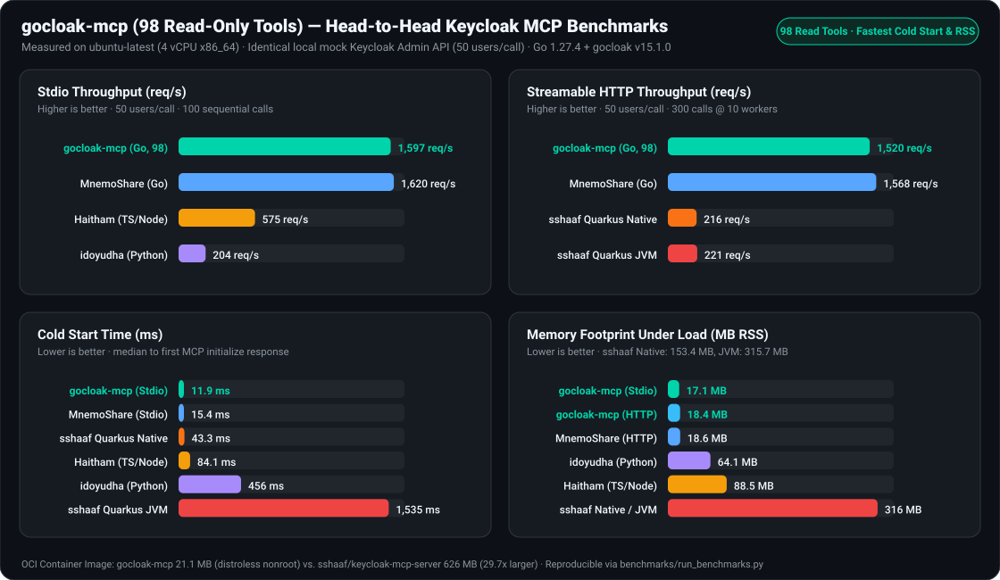

# gocloak-mcp

[](https://github.com/Nerzal/gocloak-mcp/actions/workflows/ci.yml)
[](https://github.com/Nerzal/gocloak-mcp/releases/latest)
[](https://go.dev/)
[](https://github.com/Nerzal/gocloak-mcp/pkgs/container/gocloak-mcp)
[](LICENSE)

A security-first, read-only Keycloak MCP server built in Go with the official
MCP Go SDK and GoCloak v15. Supports **Stdio** (default) and **Streamable HTTP**
transports, multi-realm allowlisting, and **feature-complete read-only coverage (98 tools across 10 domains)**:
Users & Attack Detection, Clients & Client Scopes, Roles & Composites, Groups & Hierarchies,
Realms, Keys/JWKS & Events, Authentication Flows & Required Actions, Identity Providers & Mappers,
Keycloak 26+ Organizations, Components / User Federation (LDAP/Kerberos), and Fine-Grained Authorization Services (UMA/Authz).

In Stdio mode, standard output is strictly reserved for JSON-RPC frames and all
structured JSON logs are written to standard error with automatic redaction.

## Performance Benchmarks (`v0.3.0`)



Measured head-to-head on `ubuntu-latest` (4 vCPU `x86_64`) against an identical local mock Keycloak Admin API (50 users/call). See [Security & Benchmarks](docs/SECURITY_AND_BENCHMARKS.md) for the full OWASP MCP Top 10 control matrix, `pprof` optimization progression, and reproducible harness ([`benchmarks/run_benchmarks.py`](benchmarks/run_benchmarks.py)):

| Server | Transport | Binary / Image | Cold Start | RSS (Load) | Throughput |
| --- | --- | ---: | ---: | ---: | ---: |
| **`gocloak-mcp` (`v0.3.0`, Go 1.27 + `gocloak v15.1`)** | **Stdio / HTTP** | **10.2 MB / 21.1 MB** | **9.9 ms / 22.7 ms** | **16.2 MB / 17.4 MB** | **1,227 / 1,140 req/s** |
| `MnemoShare/mnemoshare-keycloak-mcp` (Go) | Stdio / HTTP | 10.4 MB | 20.0 ms / 21.7 ms | 17.4 MB / 18.5 MB | 1,161 / 1,120 req/s |
| `HaithamOumerzoug/keycloak-mcp` (TS/Node 22) | Stdio | Node runtime | 114.1 ms | 97.6 MB | 480 req/s |
| `idoyudha/mcp-keycloak` (Python 3.12 / FastMCP) | Stdio | Python venv | 591.4 ms | 64.1 MB | 145 req/s |
| `sshaaf/keycloak-mcp-server` (Quarkus Native) | HTTP | 74.1 MB | 63.5 ms | 151.4 MB | 205 req/s |
| `sshaaf/keycloak-mcp-server` (Quarkus JVM) | HTTP | 23.4 MB JAR / 626 MB | 2,024.1 ms | 310.8 MB | 158 req/s |

## Requirements

- Go 1.27.4 or newer
- A Keycloak confidential client with service accounts enabled
- A client secret supplied through the environment

## Configuration

The server validates configuration before it starts and exits without printing
secrets when validation fails.

| Environment variable | Required | Default | Description |
| --- | --- | --- | --- |
| `KEYCLOAK_URL` | Yes | — | HTTPS Keycloak base URL (a `/auth` prefix is allowed); loopback HTTP is allowed for local development |
| `KEYCLOAK_REALM` | Yes | — | Default target realm and token-issuing realm |
| `KEYCLOAK_ALLOWED_REALMS` | No | `KEYCLOAK_REALM` | Comma-separated allowlist of realms tools may query (`KEYCLOAK_REALM` is always included) |
| `KEYCLOAK_CLIENT_ID` | Yes | — | Service-account client ID |
| `KEYCLOAK_CLIENT_SECRET` | Yes | — | Service-account client secret |
| `KEYCLOAK_REQUEST_TIMEOUT` | No | `15s` | Per-request timeout; valid range is `> 0` and `<= 2m` |
| `MCP_TRANSPORT` | No | `stdio` | Transport mode: `stdio` or `http` (Streamable HTTP) |
| `MCP_HTTP_ADDR` | No | `127.0.0.1:8080` | Listen address when `MCP_TRANSPORT=http` |
| `MCP_HTTP_BEARER_TOKEN` | Conditional | — | Optional on loopback; **required (min 32 chars)** when `MCP_HTTP_ADDR` binds to a non-loopback address |
| `MCP_HTTP_ALLOWED_ORIGINS` | No | Loopback only | Comma-separated additional `Origin` allowlist for browser clients on Streamable HTTP (DNS rebinding protection) |

Use your deployment platform's secret manager to provide secrets. Do not put
credentials in command-line arguments, configuration files, or logs.

## Minimal Keycloak permissions

Create a dedicated confidential client with service accounts enabled and assign
only the read-only `realm-management` roles required for the tools you use:

- `query-users`, `view-users` — user, session, credential-metadata, brute-force, federated-identity, and group-membership tools
- `query-clients`, `view-clients` — client, protocol-mapper, client-role, client-session, and client-scope tools
- `query-groups` — group, subgroup, and default-group tools
- `view-realm` — realm, key/JWKS, user-profile, role, composite-role, auth-flow, required-action, component/federation, and organization tools
- `view-identity-providers` — identity provider and IdP mapper tools
- `view-authorization` — fine-grained authorization (resource server, resources, scopes, policies, permissions) tools
- `view-events` — login and admin event tools

Do not use the `master` realm or grant `realm-admin` unless explicitly required.

## Installation

### Homebrew (macOS & Linux)

```sh
brew install --cask nerzal/tap/gocloak-mcp
```

### Prebuilt binaries (GitHub Releases)

Download the archive for your platform (`darwin`, `linux`, `windows` for `amd64` and `arm64`) from the [GitHub Releases](https://github.com/Nerzal/gocloak-mcp/releases) page, verify the SHA-256 checksum against `checksums.txt`, and place `gocloak-mcp` on your `PATH`.

### Docker / GHCR (multi-arch: `linux/amd64`, `linux/arm64`)

```sh
docker pull ghcr.io/nerzal/gocloak-mcp:latest
```

The image contains a static binary on `gcr.io/distroless/static-debian12:nonroot`.

### Go install (from source)

```sh
go install github.com/Nerzal/gocloak-mcp/cmd/gocloak-mcp@latest
```

## MCP client configuration

### Native binary (Stdio)

Works with Claude Desktop, Cursor, VS Code, Claude Code, and other Stdio MCP clients:

```json
{
  "mcpServers": {
    "keycloak": {
      "command": "gocloak-mcp",
      "env": {
        "KEYCLOAK_URL": "https://keycloak.example.com",
        "KEYCLOAK_REALM": "example",
        "KEYCLOAK_CLIENT_ID": "gocloak-mcp",
        "KEYCLOAK_CLIENT_SECRET": "<injected by your secret manager>"
      }
    }
  }
}
```

### Docker container (Stdio)

Run isolated without installing a local binary:

```json
{
  "mcpServers": {
    "keycloak": {
      "command": "docker",
      "args": [
        "run", "-i", "--rm",
        "-e", "KEYCLOAK_URL",
        "-e", "KEYCLOAK_REALM",
        "-e", "KEYCLOAK_CLIENT_ID",
        "-e", "KEYCLOAK_CLIENT_SECRET",
        "ghcr.io/nerzal/gocloak-mcp:latest"
      ],
      "env": {
        "KEYCLOAK_URL": "https://keycloak.example.com",
        "KEYCLOAK_REALM": "example",
        "KEYCLOAK_CLIENT_ID": "gocloak-mcp",
        "KEYCLOAK_CLIENT_SECRET": "<injected by your secret manager>"
      }
    }
  }
}
```

## Run directly

### Stdio mode (default)

```sh
export KEYCLOAK_URL=https://keycloak.example.com
export KEYCLOAK_REALM=example
export KEYCLOAK_CLIENT_ID=gocloak-mcp
export KEYCLOAK_CLIENT_SECRET='<injected by your secret manager>'
go run ./cmd/gocloak-mcp
```

### Streamable HTTP mode

```sh
export MCP_TRANSPORT=http
export MCP_HTTP_ADDR=127.0.0.1:8080
export MCP_HTTP_BEARER_TOKEN='<at least 32 random chars for non-loopback>'
go run ./cmd/gocloak-mcp
```

Or via Docker:

```sh
docker run --rm -p 127.0.0.1:8080:8080 \
  -e MCP_TRANSPORT=http \
  -e MCP_HTTP_ADDR=0.0.0.0:8080 \
  -e MCP_HTTP_BEARER_TOKEN='<at least 32 random chars>' \
  -e KEYCLOAK_URL=https://keycloak.example.com \
  -e KEYCLOAK_REALM=example \
  -e KEYCLOAK_CLIENT_ID=gocloak-mcp \
  -e KEYCLOAK_CLIENT_SECRET='<injected by your secret manager>' \
  ghcr.io/nerzal/gocloak-mcp:latest
```

Exposes `/mcp` (Streamable HTTP MCP endpoint) and `/healthz` (liveness probe).

## Read-Only Tools (98)

All 98 tools declare `readOnlyHint: true`, `idempotentHint: true`, and
`destructiveHint: false`, accept an optional `realm` parameter checked against
`KEYCLOAK_ALLOWED_REALMS`, cap pagination at `max <= 100` (default `50`), and
return safe allowlist DTOs (never exposing credentials/hashes, client secrets,
registration access tokens, IdP/component config secrets, organization invite
bearer links, or raw admin-event payloads). `get_client_secret` is intentionally
excluded to enforce OWASP MCP01.

- **Users & Attack Detection (14):** `list_users`, `get_user`, `count_users`, `get_user_sessions`, `get_user_offline_sessions`, `get_user_groups`, `get_user_roles`, `get_user_credentials`, `get_user_federated_identities`, `get_user_brute_force_status`, `get_user_composite_realm_roles`, `get_user_composite_client_roles`, `get_user_available_realm_roles`, `get_user_available_client_roles`
- **Clients & Client Scopes (19):** `list_clients`, `get_client`, `get_client_service_account`, `list_client_roles`, `get_client_role`, `get_client_protocol_mappers`, `get_client_default_scopes`, `get_client_optional_scopes`, `get_client_scope_mappings`, `get_client_sessions`, `get_client_offline_sessions`, `list_client_scopes`, `get_client_scope`, `list_client_scope_protocol_mappers`, `get_client_scope_protocol_mapper`, `get_default_default_client_scopes`, `get_default_optional_client_scopes`, `get_client_scope_realm_roles`, `get_client_scope_client_roles`
- **Roles & Composites (9):** `list_realm_roles`, `get_realm_role`, `get_role_by_id`, `get_realm_role_composites`, `get_role_composites_by_id`, `get_users_in_role`, `get_users_in_client_role`, `get_groups_in_role`, `get_groups_in_client_role`
- **Groups & Hierarchies (12):** `list_groups`, `count_groups`, `get_group`, `get_group_by_path`, `list_child_groups`, `get_default_groups`, `get_group_members`, `get_group_roles`, `get_group_composite_realm_roles`, `get_group_composite_client_roles`, `get_group_available_realm_roles`, `get_group_available_client_roles`
- **Realms, Keys, Events & Server Info (9):** `list_realms`, `get_realm_info`, `get_realm_keys`, `get_realm_certs`, `get_realm_issuer`, `get_user_profile_config`, `get_server_info`, `list_events`, `list_admin_events`
- **Authentication Flows & Required Actions (7):** `list_authentication_flows`, `get_authentication_flow`, `get_flow_executions`, `get_authenticator_config`, `list_required_actions`, `get_required_action`, `list_unregistered_required_actions`
- **Identity Providers (4):** `list_identity_providers`, `get_identity_provider`, `list_identity_provider_mappers`, `get_identity_provider_mapper`
- **Organizations — Keycloak 26+ (10):** `list_organizations`, `get_organization`, `count_organizations`, `get_organization_members`, `count_organization_members`, `get_organization_member`, `get_user_organizations`, `list_organization_identity_providers`, `list_organization_invitations`, `list_organization_groups`
- **Components / User Federation (2):** `list_components`, `get_component`
- **Fine-Grained Authorization Services (12):** `get_resource_server`, `list_authz_resources`, `get_authz_resource`, `list_authz_scopes`, `get_authz_scope`, `list_authz_policies`, `get_authz_policy`, `list_authz_permissions`, `get_authz_permission`, `get_policy_associated_policies`, `get_policy_resources`, `get_policy_scopes`

## Build and verification

```sh
make check
```

## Building the container locally

```sh
docker build -t gocloak-mcp .
```
