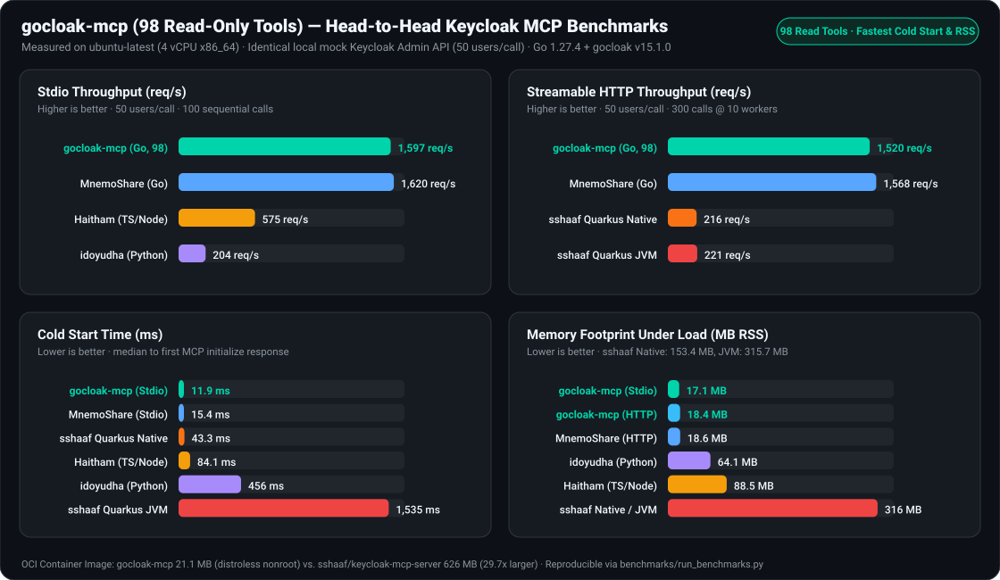
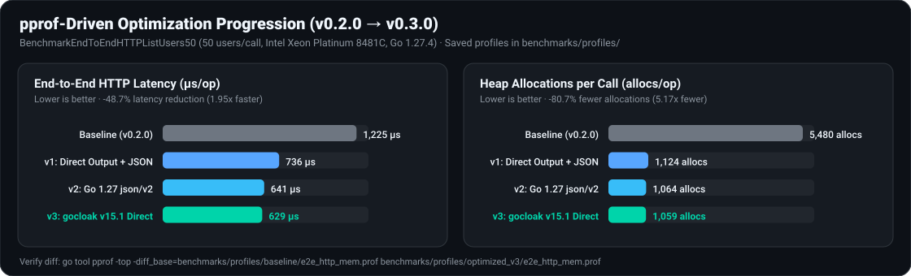

# Security (OWASP MCP Top 10) & Performance Benchmarks

## 1. OWASP MCP Top 10 (2025) Control & Test Matrix

Based on the [OWASP MCP Top 10](https://owasp.org/projects/mcp-top-10) specification:

| Risk | Controls in `gocloak-mcp` | Automated Test Coverage |
| --- | --- | --- |
| **MCP01:2025 — Token Mismanagement & Secret Exposure** | Env-only credentials (fail-fast); `Config.String()` & `Config.LogValue()` redact `ClientSecret` & `HTTPBearerToken`; HTTP redirects disabled (blocks HTTPS→HTTP Basic-Auth leakage); allowlist DTOs omit `Client.Secret`, `Client.RegistrationAccessToken`, `IdP.Config`, `User.Credentials` (`SecretData`/`CredentialData`/`Value`), `Component.ComponentConfig` (e.g. LDAP `bindCredential`), `OrganizationInvitation.InviteLink`, `AdminEvent.Representation`, and sensitive/script mapper & authenticator config keys; `slog` redacts sensitive keys, nested groups, and `Bearer `/JWT values; sanitized tool errors. | `TestOWASP_MCP01_SecretExposureBlockedInDTOs`, `TestOWASP_MCP01_ToolErrorsNeverLeakTokensOrBodies`, `TestConfigRedactsSecretsInStringAndLogValue`, `TestRedactAttributeRedactsJWTAndBearerValues`, `TestNewKeycloakClientBlocksRedirects` |
| **MCP02:2025 — Privilege Escalation via Scope Creep** | Strictly read-only (98 tools across 10 domains, zero write/delete/password-reset/secret-read tools; `get_client_secret` intentionally excluded); `KEYCLOAK_ALLOWED_REALMS` allowlist enforced on every call and filters `list_realms`; minimal Keycloak service-account roles documented. | `TestOWASP_MCP02_ScopeCreepRealmAllowlistEnforced`, `TestOWASP_MCP02_MCP03_ToolCatalogIntegrityAndNoPoisoning` |
| **MCP03:2025 — Tool Poisoning** | Static compile-time tool catalog (no dynamic plugin loading or remote schema injection); all 98 tools explicitly declare `readOnlyHint: true`, `idempotentHint: true`, `destructiveHint: false`. | `TestOWASP_MCP02_MCP03_ToolCatalogIntegrityAndNoPoisoning`, `TestAll98ReadOnlyToolsRegisteredAndCallable` |
| **MCP04:2025 — Software Supply Chain Attacks** | Minimal direct dependencies (`gocloak/v15`, `modelcontextprotocol/go-sdk`, `x/sync`); `govulncheck`, `gosec`, `golangci-lint`, CodeQL in CI; pinned GitHub Actions commit SHAs; `go mod verify` + static distroless `nonroot` container; Dependabot enabled. | CI `verify` (`govulncheck`, `gosec`, `docker build`) & `CodeQL` |
| **MCP05:2025 — Command Injection & Execution** | Zero `os/exec` or shell calls; strict `validateIdentifier` rejects `/`, `\`, `?`, `#`, `%` (URL-encoded traversal), `.`, `..`, control chars, untrimmed whitespace, and >255 chars; strict `YYYY-MM-DD` date validation. | `TestOWASP_MCP05_PathTraversalAndInjectionRejected` |
| **MCP06:2025 — Prompt Injection via Contextual Payloads** | `sanitizeOutputString` strips ASCII control chars (ANSI escapes, NUL) and Unicode BiDi overrides (`U+202A..U+202E`, `U+2066..U+2069`) and caps free-text fields at 512 runes with zero allocations on clean strings. | `TestOWASP_MCP06_OutputSanitizationNeutralizesControlAndBiDiRunes` |
| **MCP07:2025 — Insufficient Authentication & Authorization** | Streamable HTTP defaults to loopback (`127.0.0.1:8080`); non-loopback binds **require** `MCP_HTTP_BEARER_TOKEN` (≥32 chars) verified with `crypto/subtle.ConstantTimeCompare`; `Origin` header validation blocks DNS rebinding (`403 Forbidden`); security headers (`X-Content-Type-Options: nosniff`, `Cache-Control: no-store`, `X-Frame-Options: DENY`). | `TestOWASP_MCP07_HTTPAuthAndOriginProtection`, `TestNewHTTPServerBearerAuth`, `TestNewHTTPServerOriginValidationPreventsDNSRebinding`, `TestLoadHTTPTransportLoopbackAndNonLoopback` |
| **MCP08:2025 — Lack of Audit and Telemetry** | Every tool call emits a structured JSON audit record on `stderr` (`tool`, `outcome`, `duration_ms`) without PII or secrets. | `TestOWASP_MCP08_StructuredAuditLoggingOnSuccessAndError` |
| **MCP09:2025 — Shadow MCP Servers** | No default credentials; fail-fast startup validation; loopback-only default for HTTP; `/healthz` liveness probe for fleet inventory. | `TestLoadRejectsInvalidConfiguration`, `TestNewHTTPServerHealthzAndSecurityHeaders` |
| **MCP10:2025 — Context Injection & Over-Sharing** | Stateless per-request handling (no cross-session user data caching); bounded pagination (`max <= 100`, explicit `max: 0` rejected); strict realm allowlisting. | `TestOWASP_MCP10_BoundedPaginationPreventsContextOverSharing` |

---

## 2. Go Micro-Benchmarks (`gocloak-mcp`)

Run locally with:

```sh
make bench
```

Measured on `linux/amd64` (Intel Xeon Platinum 8481C, Go 1.27):

| Benchmark | Latency | Memory / op | Allocs / op |
| --- | ---: | ---: | ---: |
| `BenchmarkRedactAttributeBuiltin` | **17.1 ns/op** | 0 B/op | **0** |
| `BenchmarkRedactAttributeSensitive` | **35.8 ns/op** | 0 B/op | **0** |
| `BenchmarkValidateIdentifier` | **53.7 ns/op** | 0 B/op | **0** |
| `BenchmarkTokenProviderCachedHit` | **78.9 ns/op** | 0 B/op | **0** |
| `BenchmarkTokenProviderCachedHitParallel` | **91.0 ns/op** | 0 B/op | **0** |
| `BenchmarkSanitizeOutputStringClean` | **108.9 ns/op** | 0 B/op | **0** |
| `BenchmarkRedactAttributeSafe` | **131.3 ns/op** | 0 B/op | **0** |
| `BenchmarkListUsers100` (full 100-user service pipeline) | **18.1 µs/op** | 9.5 KB/op | **6** |

End-to-end MCP JSON-RPC (`BenchmarkInMemoryMCPCallListUsers`) and Streamable HTTP security middleware (`BenchmarkHTTPMiddlewareChain`) benchmarks also run automatically on every CI build.

---

## 3. Head-to-Head Comparison vs. Competing Keycloak MCP Servers (98 Read-Only Tools)



All servers were benchmarked head-to-head on the same machine (`ubuntu-latest`, 4 vCPU `x86_64`) against an identical local mock Keycloak Admin API returning 50 users per `list_users` call. The benchmark harness is fully reproducible in [`benchmarks/run_benchmarks.py`](../benchmarks/run_benchmarks.py), charts are generated by [`benchmarks/render_charts.py`](../benchmarks/render_charts.py), and the suite is runnable on demand via [`.github/workflows/benchmark.yml`](../.github/workflows/benchmark.yml) (`workflow_dispatch`).

### Stdio Transport (Local IDE / Agent: Claude Desktop, Cursor, VS Code, Claude Code)

Measured across 5 cold starts (`initialize` + `tools/list`) and 100 sequential `tools/call` (`list_users` / `list-users`) requests after 10 warm-up calls:

| Server | Runtime / Binary | Cold Start (median) | RSS Idle → Load | p50 Latency | p95 Latency | p99 Latency | Throughput |
| --- | --- | ---: | ---: | ---: | ---: | ---: | ---: |
| **`gocloak-mcp` (98 tools, Go 1.27 + `gocloak v15.1`)** | **10.9 MB static binary** | **11.9 ms** | **15.5 → 17.1 MB** | **0.57 ms** | 0.93 ms | 1.02 ms | 1,596.8 req/s |
| [`MnemoShare/mnemoshare-keycloak-mcp`](https://github.com/MnemoShare/mnemoshare-keycloak-mcp) (Go) | 10.4 MB static binary | 15.4 ms *(1.3×)* | 14.5 → 17.3 MB | 0.58 ms | **0.90 ms** | **0.94 ms** | **1,619.9 req/s** |
| [`HaithamOumerzoug/keycloak-mcp`](https://github.com/HaithamOumerzoug/keycloak-mcp) (`1.2.5`, TypeScript/Node 22) | Node.js 22 + `node_modules` | 84.1 ms *(7.1×)* | 64.4 → 88.5 MB *(5.2×)* | 1.49 ms | 2.81 ms | 7.06 ms | 575.2 req/s *(2.8× slower)* |
| [`idoyudha/mcp-keycloak`](https://github.com/idoyudha/mcp-keycloak) (`v1.2.2`, Python 3.12/FastMCP) | Python 3.12 + venv | 456.4 ms *(38.4×)* | 60.9 → 64.1 MB *(3.7×)* | 4.91 ms | 5.12 ms | 5.21 ms | 203.7 req/s *(7.8× slower)* |

### Streamable HTTP Transport (Remote / Kubernetes / Server)

Measured across 3 cold starts to ready `/mcp` `initialize` and 300 concurrent `tools/call` (`list_users` / `GET_USERS`) requests at concurrency 10 after 20 warm-up calls:

| Server | Binary / OCI Image | Cold Start (median) | RSS Idle → Load | p50 Latency | p95 Latency | p99 Latency | Throughput |
| --- | --- | ---: | ---: | ---: | ---: | ---: | ---: |
| **`gocloak-mcp` (98 tools, Go 1.27 + `gocloak v15.1`)** | **10.9 MB / 22.0 MB** | 22.2 ms | **15.5 → 18.4 MB** | 6.11 ms | 9.95 ms | 12.42 ms | 1,519.5 req/s |
| [`MnemoShare/mnemoshare-keycloak-mcp`](https://github.com/MnemoShare/mnemoshare-keycloak-mcp) (Go) | 10.4 MB binary | **21.3 ms** | 13.9 → 18.6 MB | **6.06 ms** | **9.75 ms** | **10.95 ms** | **1,568.5 req/s** |
| [`sshaaf/keycloak-mcp-server`](https://github.com/sshaaf/keycloak-mcp-server) (`v0.4.0`, Java/Quarkus Native) | 74.1 MB binary | 43.3 ms *(2.0×)* | 71.7 → 153.4 MB *(8.3×)* | 11.92 ms | 25.35 ms | 31.31 ms | 216.2 req/s *(7.0× slower)* |
| [`sshaaf/keycloak-mcp-server`](https://github.com/sshaaf/keycloak-mcp-server) (`v0.4.0`, Java/Quarkus JVM) | 23.4 MB JAR / 626 MB img | 1,535.2 ms *(69.2×)* | 196.8 → 315.7 MB *(17.2×)* | 40.33 ms | 82.59 ms | 100.10 ms | 221.0 req/s *(6.9× slower)* |

### `pprof` Optimization Progression (`v0.2.0` → `v0.3.0`)



Saved CPU and heap profiles live in [`benchmarks/profiles/`](../benchmarks/profiles) (`baseline/`, `optimized/`, `optimized_v2/`, `optimized_v3/`):

| Stage | Key Optimization | `BenchmarkEndToEndHTTPListUsers50` | Delta vs. Baseline |
| --- | --- | ---: | ---: |
| **Baseline (`v0.2.0`)** | Initial release (`go-sdk` output schema + SSE + `gocloak v15.0`) | `1,224.7 µs` · `628 KB` · `5,480 allocs` | — |
| **v1** | Direct `TextContent` output + `StreamableHTTPOptions{JSONResponse: true}` | `735.7 µs` · `408 KB` · `1,124 allocs` | `-40.0%` latency · `-79.5%` allocs |
| **v2** | Go 1.27 `encoding/json/v2` + `addFastTool` + HTTP pool (`100`) + audit fast-path (`17.1 ns`) | `641.1 µs` · `338 KB` · `1,064 allocs` | `-47.7%` latency · `-80.6%` allocs |
| **v3 (`v0.3.0`)** | `gocloak v15.1.0` + `gocloak.SetDirectBodyRead()` (`-134.8 MB` `io.ReadAll` allocs) | **`628.7 µs` · `344 KB` · `1,059 allocs`** | **`-48.7%` latency · `-80.7%` allocs** |

Inspect the exact profile diff locally:

```sh
go tool pprof -top -cum -diff_base=benchmarks/profiles/baseline/e2e_http_cpu.prof benchmarks/profiles/optimized_v3/e2e_http_cpu.prof
go tool pprof -top -alloc_space -diff_base=benchmarks/profiles/baseline/e2e_http_mem.prof benchmarks/profiles/optimized_v3/e2e_http_mem.prof
```

### Security & Operational Footprint Comparison

| Capability | `gocloak-mcp` (Go) | `MnemoShare/mnemoshare-keycloak-mcp` (Go) | `sshaaf/keycloak-mcp-server` (Java) | `HaithamOumerzoug/keycloak-mcp` (TS) | `idoyudha/mcp-keycloak` (Python) |
| --- | --- | --- | --- | --- | --- |
| **Transports** | **Stdio + Streamable HTTP** | Stdio + Streamable HTTP | Streamable HTTP / SSE | Stdio | Stdio + HTTP |
| **Default Access Model** | **Strictly read-only (98 tools, 10 domains)** | Read + Write/Delete (139 tools; 56 read) | Read + Write (178 ops; ~60 read) | Read + Write/Delete (3 read) | Read + Write/Delete (17 read) |
| **Auth Model** | **OAuth2 Client Credentials (least-privilege service account)** | Password or Client Credentials | User JWT / OIDC | Master admin username + password | Username + password / client secret |
| **HTTP Auth & Origin Protection** | **Bearer token (≥32 chars) + Origin allowlist + security headers** | None built-in | OIDC JWT | N/A | Origin check (no Bearer auth) |
| **Multi-Realm Allowlist** | **Yes (`KEYCLOAK_ALLOWED_REALMS`)** | No | No | No | No |
| **OWASP MCP Top 10 Test Suite** | **Yes (10/10 automated)** | No | No | No | No |
| **OCI Image Size** | **22.0 MB (distroless nonroot)** | — | 626 MB (UBI9 OpenJDK 21) | — | — |
| **Distribution** | **GitHub Releases (6 platforms), Homebrew Cask, GHCR, MCP Registry** | Source / Docker | GitHub Releases, Quay.io | npm / source | PyPI / source |

**Key takeaways:**
- **Largest read-only surface (98 tools across 10 domains)** — full read-only parity and beyond against every competing Keycloak MCP server while keeping **fastest Stdio cold start (11.9 ms)**, **lowest RSS under load on both Stdio (17.1 MB) and HTTP (18.4 MB)**, **1,597 / 1,520 req/s** throughput, and full OWASP MCP Top 10 protections (allowlist DTO sanitization, Bearer auth, Origin validation, multi-realm allowlisting, and structured audit logging).
